<h1 align="center">MHGURecomp-mods</h1>

<p align="center">
<a href="https://github.com/morerokk/MHGURecomp/releases/latest"></a>
<a href="https://github.com/morerokk/MHGURecomp"></a>
</p>

**A curated directory of mods tested with [MHGU Recomp](https://github.com/morerokk/MHGURecomp)**

Each entry links to the mod's download page, with install steps and the versions and platforms it has been tested on.

No mod files are hosted here, only links. Download each mod from its author's page.

<h2 align="center">Installing mods</h2>

Every mod here is for MHGU 1.4.0, the game's final update, which MHGU Recomp requires.

MHGU Recomp loads mods from a `mods` folder next to the recomp executable. Each mod gets its own folder:

```
mods/
└── <mod-name>/
    ├── romfs/   # replacement game data files
    └── exefs/   # exefs patches
```

Most mods only use one of the two folders. If a mod was packaged for an emulator (for example a Yuzu or Ryujinx `romfs`/`exefs` layout), copy those folders into `mods/<mod-name>/`. Check the mod's page here for anything specific to it.

<h2 align="center">Mod list</h2>

<p align="center">
<a href="CONTRIBUTING.md"></a>
<a href="../../issues/new?template=report-mod-issue.yml"></a>
</p>

<h3 align="center">Compatibility status</h3>

<div align="center">

<table>
<tr><th>Status</th><th>Meaning</th></tr>
<tr><td align="center">🟢</td><td>Full compatibility: everything the mod does works with the recomp.</td></tr>
<tr><td align="center">🟡</td><td>Partial: the mod loads, but some of its features are missing or broken.</td></tr>
<tr><td align="center">🔴</td><td>Broken: the mod doesn't work, or crashes the game.</td></tr>
</table>

</div>

<h3 align="center">Dependencies</h3>

These aren't mods you play with on their own, but many of the mods below need them. Install them first. Each mod card says whether it requires Forge.

<div align="center">

<table>
<tr>
<td align="center" width="380"><a href="mods/forge/preview.jpg">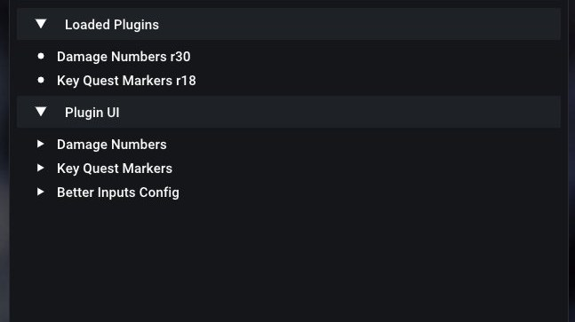</a></td>
<td width="520">
<h3><a href="mods/forge/README.md">Forge</a> 🟢</h3>
<b>Author:</b> Fexty12573<br>
<b>Download:</b> <a href="https://github.com/Fexty12573/forge">GitHub</a><br>
<b>Tested recomp version:</b> 0.9.1.0<br>
<b>Tested platform:</b> Linux<br>
<a href="mods/forge/README.md">Install steps and details</a>
</td>
</tr>
</table>

<table>
<tr>
<td align="center" width="380"><a href="mods/katlib/preview.jpg"></a></td>
<td width="520">
<h3><a href="mods/katlib/README.md">KatLib</a> 🟢</h3>
<b>Author:</b> Katt404<br>
<b>Download:</b> <a href="https://gamebanana.com/mods/732712">GameBanana</a><br>
<b>Requires <a href="mods/forge/README.md">Forge</a>:</b> Yes<br>
<b>Tested recomp version:</b> 0.10.7<br>
<b>Tested platform:</b> Linux<br>
<a href="mods/katlib/README.md">Install steps and details</a>
</td>
</tr>
</table>

</div>

<h3 align="center">Mods</h3>

<!-- mods:start -->
<div align="center">

<table>
<tr>
<td align="center" width="380"><a href="mods/armor-fusion/preview.jpg">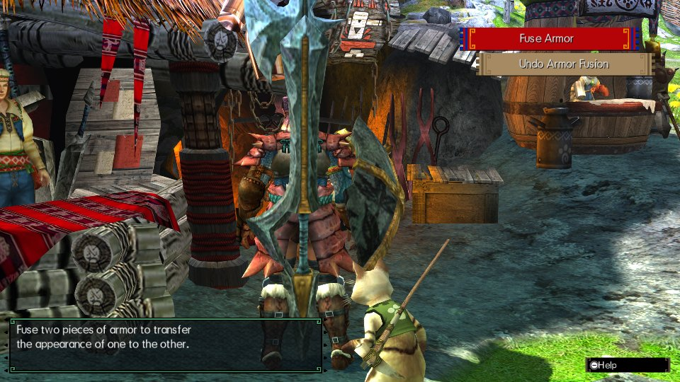</a></td>
<td width="520">
<h3><a href="mods/armor-fusion/README.md">Armor Fusion</a> 🟢</h3>
<b>Author:</b> <a href="https://github.com/Rikiar73574">Rikiar73574</a><br>
<b>Download:</b> <a href="https://github.com/Rikiar73574/mhgu-armor-fusion/releases/tag/v0.1.0">GitHub</a><br>
<b>Requires <a href="mods/forge/README.md">Forge</a>:</b> Yes (1.5.1, built into tested Recomp)<br>
<b>Tested recomp version:</b> Stock source build <code>a272b61</code><br>
<b>Tested platform:</b> Linux<br>
<a href="mods/armor-fusion/README.md">Install steps and details</a>
</td>
</tr>
</table>

<table>
<tr>
<td align="center" width="380"><a href="mods/better-inputs/preview.jpg">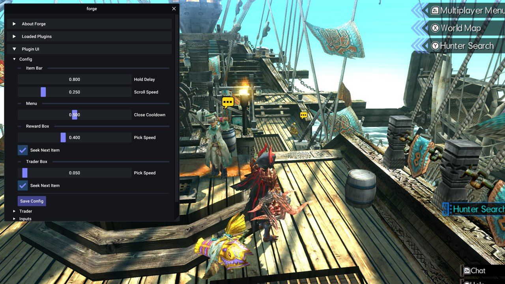</a></td>
<td width="520">
<h3><a href="mods/better-inputs/README.md">Better Inputs</a> 🟢</h3>
<b>Author:</b> Fexty12573<br>
<b>Download:</b> <a href="https://gamebanana.com/mods/689270">GameBanana</a><br>
<b>Requires <a href="mods/forge/README.md">Forge</a>:</b> Yes (1.4.0 or newer)<br>
<b>Tested recomp version:</b> 0.10.7<br>
<b>Tested platform:</b> Linux<br>
<a href="mods/better-inputs/README.md">Install steps and details</a>
</td>
</tr>
</table>

<table>
<tr>
<td align="center" width="380"><a href="mods/damage-numbers/preview.jpg">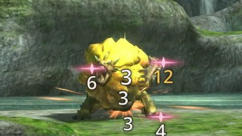</a></td>
<td width="520">
<h3><a href="mods/damage-numbers/README.md">Damage Numbers</a> 🟢</h3>
<b>Author:</b> PurplefinNeptuna<br>
<b>Download:</b> <a href="https://gamebanana.com/mods/725408">GameBanana</a><br>
<b>Requires <a href="mods/forge/README.md">Forge</a>:</b> Yes (1.4.1)<br>
<b>Tested recomp version:</b> 0.10.7<br>
<b>Tested platform:</b> Linux<br>
<a href="mods/damage-numbers/README.md">Install steps and details</a>
</td>
</tr>
</table>

<table>
<tr>
<td align="center" width="380"><a href="mods/faster-field-hunter/preview.jpg">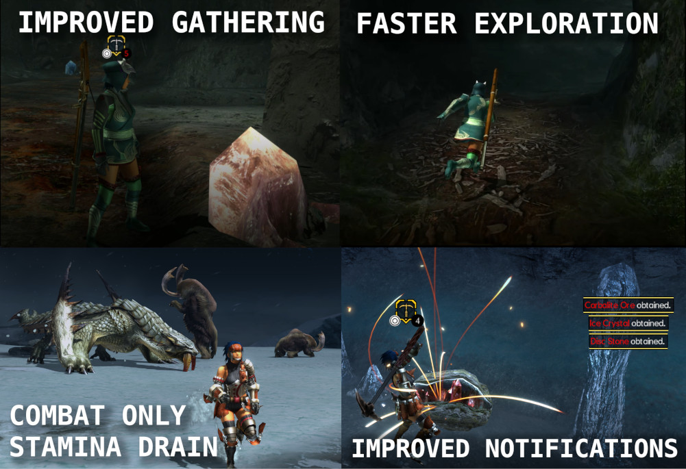</a></td>
<td width="520">
<h3><a href="mods/faster-field-hunter/README.md">Faster Field Hunter</a> 🟢</h3>
<b>Author:</b> Ellipse1638<br>
<b>Download:</b> <a href="https://gamebanana.com/mods/735791">GameBanana</a><br>
<b>Requires <a href="mods/forge/README.md">Forge</a>:</b> Yes (1.0+)<br>
<b>Tested recomp version:</b> 0.13.1<br>
<b>Tested platform:</b> Linux<br>
<a href="mods/faster-field-hunter/README.md">Install steps and details</a>
</td>
</tr>
</table>

<table>
<tr>
<td align="center" width="380"><a href="mods/ff14-damage-text/preview.jpg">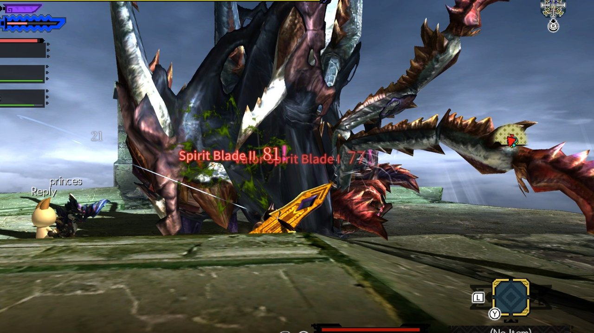</a></td>
<td width="520">
<h3><a href="mods/ff14-damage-text/README.md">FF14-style Damage Text</a> 🟢</h3>
<b>Author:</b> Filianore<br>
<b>Download:</b> <a href="https://gamebanana.com/mods/727751">GameBanana</a><br>
<b>Requires <a href="mods/forge/README.md">Forge</a>:</b> Yes (1.4.1)<br>
<b>Tested recomp version:</b> 0.10.7<br>
<b>Tested platform:</b> Linux<br>
<a href="mods/ff14-damage-text/README.md">Install steps and details</a>
</td>
</tr>
</table>

<table>
<tr>
<td align="center" width="380"><a href="mods/dualshock-buttons/preview.jpg">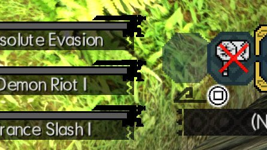</a></td>
<td width="520">
<h3><a href="mods/dualshock-buttons/README.md">Full DualShock Buttons</a> 🟢</h3>
<b>Author:</b> Abbanon<br>
<b>Download:</b> <a href="https://gamebanana.com/mods/475878">GameBanana</a><br>
<b>Requires <a href="mods/forge/README.md">Forge</a>:</b> No<br>
<b>Tested recomp version:</b> 0.10.7<br>
<b>Tested platform:</b> Linux<br>
<a href="mods/dualshock-buttons/README.md">Install steps and details</a>
</td>
</tr>
</table>

<table>
<tr>
<td align="center" width="380"><a href="mods/hunters-compendium/preview.jpg">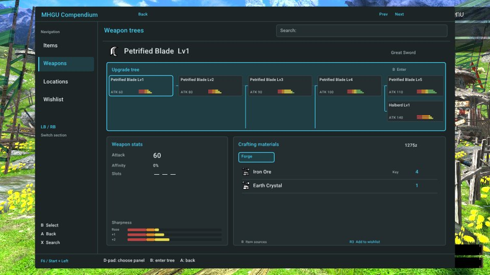</a></td>
<td width="520">
<h3><a href="mods/hunters-compendium/README.md">Hunter's Compendium</a> 🟢</h3>
<b>Author:</b> <a href="https://github.com/Rikiar73574">Rikiar73574</a><br>
<b>Download:</b> <a href="https://github.com/Rikiar73574/mhgu-compendium/releases/tag/v0.2.0">GitHub (v0.2.0)</a><br>
<b>Requires <a href="mods/forge/README.md">Forge</a>:</b> Yes (1.5.1, built into the tested Recomp build)<br>
<b>Tested recomp version:</b> Stock source build <code>a272b61</code><br>
<b>Tested platform:</b> Linux<br>
<a href="mods/hunters-compendium/README.md">Install steps and details</a>
</td>
</tr>
</table>

<table>
<tr>
<td align="center" width="380"><a href="mods/key-quest-markers/preview.jpg">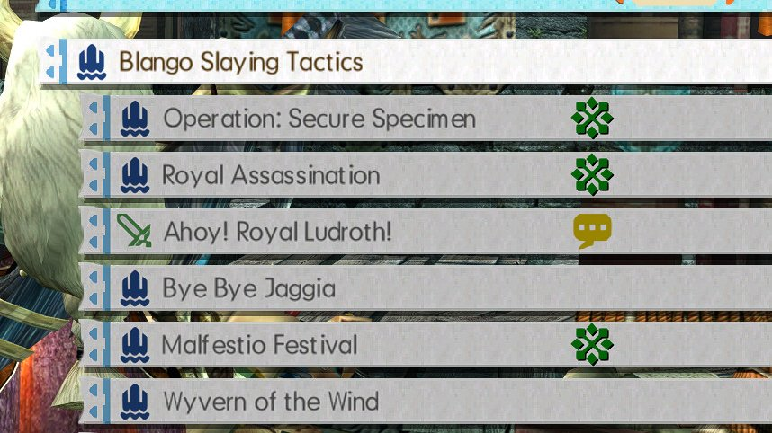</a></td>
<td width="520">
<h3><a href="mods/key-quest-markers/README.md">Key Quest Markers</a> 🟢</h3>
<b>Author:</b> PurplefinNeptuna<br>
<b>Download:</b> <a href="https://gamebanana.com/mods/727960">GameBanana</a><br>
<b>Requires <a href="mods/forge/README.md">Forge</a>:</b> Yes (1.5.1)<br>
<b>Tested recomp version:</b> 0.10.7<br>
<b>Tested platform:</b> Linux<br>
<a href="mods/key-quest-markers/README.md">Install steps and details</a>
</td>
</tr>
</table>

<table>
<tr>
<td align="center" width="380"><a href="mods/mapassist-monster-icons-on-the-map/preview.jpg">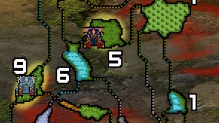</a></td>
<td width="520">
<h3><a href="mods/mapassist-monster-icons-on-the-map/README.md">MapAssist - Monster Icons on the Map</a> 🟢</h3>
<b>Author:</b> Katt404<br>
<b>Download:</b> <a href="https://gamebanana.com/mods/732716">GameBanana</a><br>
<b>Requires <a href="mods/forge/README.md">Forge</a>:</b> Yes<br>
<b>Tested recomp version:</b> 0.10.7<br>
<b>Tested platform:</b> Linux<br>
<a href="mods/mapassist-monster-icons-on-the-map/README.md">Install steps and details</a>
</td>
</tr>
</table>

<table>
<tr>
<td align="center" width="380"><a href="mods/mhgu-dps-meter/preview.jpg">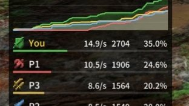</a></td>
<td width="520">
<h3><a href="mods/mhgu-dps-meter/README.md">MHGU DPS Meter</a> 🟢</h3>
<b>Author:</b> sadgnk169<br>
<b>Download:</b> <a href="https://github.com/sadgnk169/MHGU-DPS-Meter">GitHub</a><br>
<b>Requires <a href="mods/forge/README.md">Forge</a>:</b> Yes<br>
<b>Tested recomp version:</b> 0.11.2<br>
<b>Tested platform:</b> Linux<br>
<a href="mods/mhgu-dps-meter/README.md">Install steps and details</a>
</td>
</tr>
</table>

<table>
<tr>
<td align="center" width="380"><a href="mods/mhgu-hd-project/preview.jpg">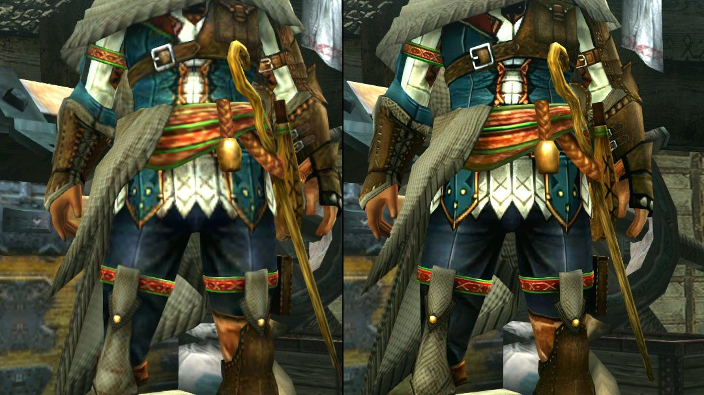</a></td>
<td width="520">
<h3><a href="mods/mhgu-hd-project/README.md">MHGU HD Project</a> 🟢</h3>
<b>Author:</b> Monkbreh<br>
<b>Download:</b> <a href="https://github.com/Monkbreh/MHGU-HD-Project">GitHub</a><br>
<b>Requires <a href="mods/forge/README.md">Forge</a>:</b> No<br>
<b>Tested recomp version:</b> 0.10.7<br>
<b>Tested platform:</b> Linux<br>
<a href="mods/mhgu-hd-project/README.md">Install steps and details</a>
</td>
</tr>
</table>

<table>
<tr>
<td align="center" width="380"><a href="mods/mhgu-xx-rebalanced/preview.jpg">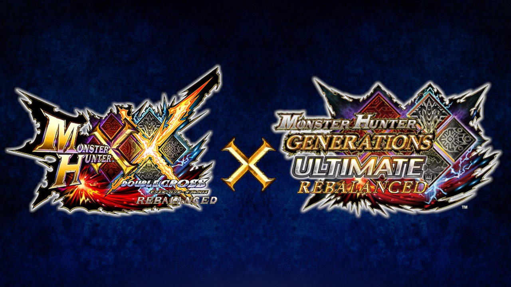</a></td>
<td width="520">
<h3><a href="mods/mhgu-xx-rebalanced/README.md">MHGU/XX Rebalanced</a> 🟢</h3>
<b>Author:</b> Potobc<br>
<b>Download:</b> <a href="https://gamebanana.com/mods/447835">GameBanana</a><br>
<b>Requires <a href="mods/forge/README.md">Forge</a>:</b> No<br>
<b>Tested recomp version:</b> 0.9.1.0<br>
<b>Tested platform:</b> Linux<br>
<a href="mods/mhgu-xx-rebalanced/README.md">Install steps and details</a>
</td>
</tr>
</table>

<table>
<tr>
<td align="center" width="380"><a href="mods/modern-weapon-trees-armor-trees-wishlist/preview.jpg">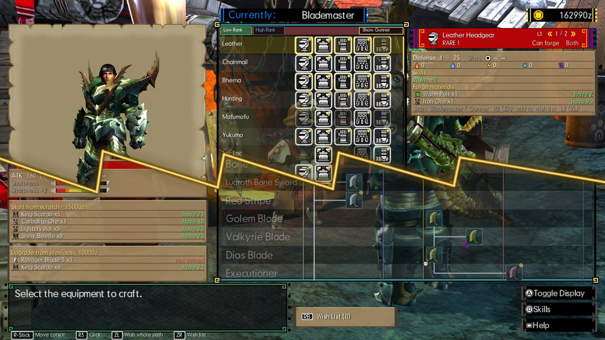</a></td>
<td width="520">
<h3><a href="mods/modern-weapon-trees-armor-trees-wishlist/README.md">Modern Weapon trees/Armor Trees/Wishlist</a> 🟢</h3>
<b>Author:</b> Xyrezia<br>
<b>Download:</b> <a href="https://gamebanana.com/mods/735331">GameBanana</a><br>
<b>Requires <a href="mods/forge/README.md">Forge</a>:</b> Yes (1.5.1)<br>
<b>Tested recomp version:</b> 0.14.0<br>
<b>Tested platform:</b> Linux<br>
<a href="mods/modern-weapon-trees-armor-trees-wishlist/README.md">Install steps and details</a>
</td>
</tr>
</table>

<table>
<tr>
<td align="center" width="380"><a href="mods/weakness-icons/preview.jpg">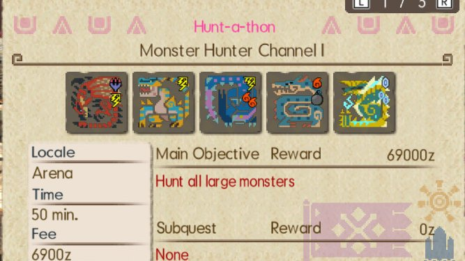</a></td>
<td width="520">
<h3><a href="mods/weakness-icons/README.md">Monster Weakness Icons</a> 🟢</h3>
<b>Author:</b> Potobc<br>
<b>Download:</b> <a href="https://gamebanana.com/mods/488552">GameBanana</a><br>
<b>Requires <a href="mods/forge/README.md">Forge</a>:</b> No<br>
<b>Tested recomp version:</b> 0.10.7<br>
<b>Tested platform:</b> Linux<br>
<a href="mods/weakness-icons/README.md">Install steps and details</a>
</td>
</tr>
</table>

<table>
<tr>
<td align="center" width="380"><a href="mods/rise-chargeblade-for-alchemy-style/preview.jpg">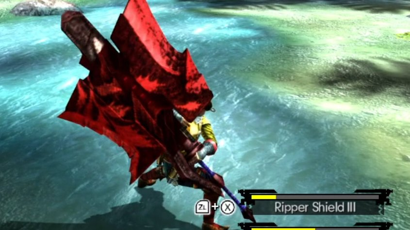</a></td>
<td width="520">
<h3><a href="mods/rise-chargeblade-for-alchemy-style/README.md">Rise Chargeblade for Alchemy Style</a> 🟢</h3>
<b>Author:</b> morerokk<br>
<b>Download:</b> <a href="https://gamebanana.com/mods/735956">GameBanana</a><br>
<b>Requires <a href="mods/forge/README.md">Forge</a>:</b> Yes<br>
<b>Tested recomp version:</b> 0.14.0<br>
<b>Tested platform:</b> Windows<br>
<a href="mods/rise-chargeblade-for-alchemy-style/README.md">Install steps and details</a>
</td>
</tr>
</table>

<table>
<tr>
<td align="center" width="380"><a href="mods/uiscale-hud-scale-and-layout-editor/preview.jpg">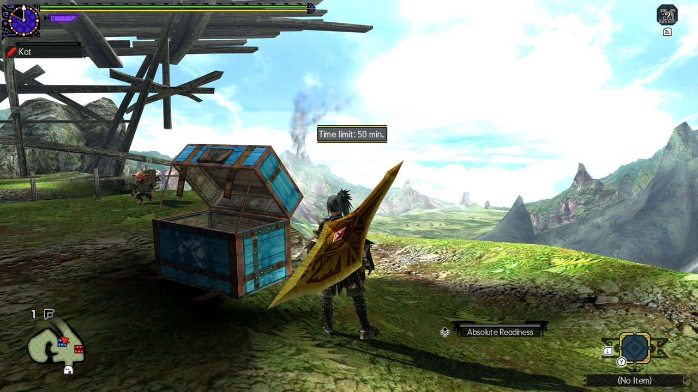</a></td>
<td width="520">
<h3><a href="mods/uiscale-hud-scale-and-layout-editor/README.md">UIScale - HUD Scale and Layout Editor</a> 🟢</h3>
<b>Author:</b> Katt404<br>
<b>Download:</b> <a href="https://gamebanana.com/mods/732711">GameBanana</a><br>
<b>Requires <a href="mods/forge/README.md">Forge</a>:</b> Yes<br>
<b>Tested recomp version:</b> 0.10.7<br>
<b>Tested platform:</b> Linux<br>
<a href="mods/uiscale-hud-scale-and-layout-editor/README.md">Install steps and details</a>
</td>
</tr>
</table>

<table>
<tr>
<td align="center" width="380"><a href="mods/world-like-sharpness-gauge/preview.jpg">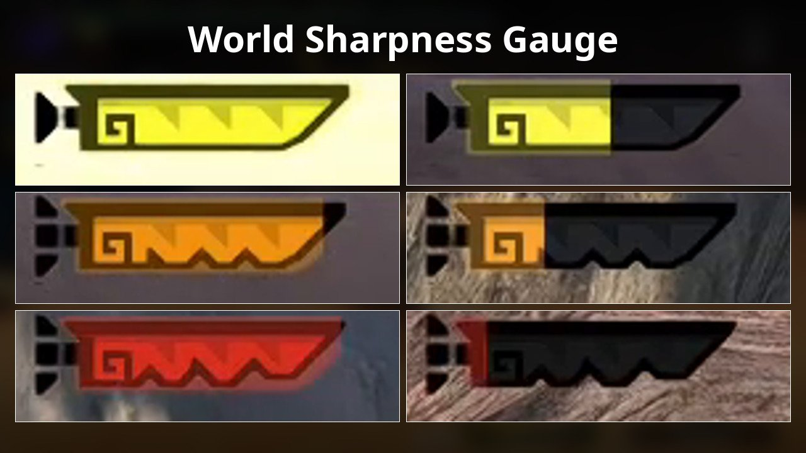</a></td>
<td width="520">
<h3><a href="mods/world-like-sharpness-gauge/README.md">World(like) Sharpness Gauge</a> 🟢</h3>
<b>Author:</b> PurplefinNeptuna<br>
<b>Download:</b> <a href="https://gamebanana.com/mods/735541">GameBanana</a><br>
<b>Requires <a href="mods/forge/README.md">Forge</a>:</b> Yes (1.5.1)<br>
<b>Tested recomp version:</b> 0.13.1<br>
<b>Tested platform:</b> Linux<br>
<a href="mods/world-like-sharpness-gauge/README.md">Install steps and details</a>
</td>
</tr>
</table>

<table>
<tr>
<td align="center" width="380"><a href="mods/xbox-layout/preview.jpg">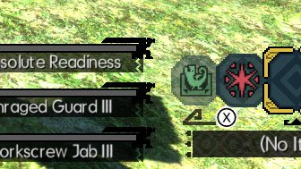</a></td>
<td width="520">
<h3><a href="mods/xbox-layout/README.md">Xbox Controller Layout</a> 🟢</h3>
<b>Author:</b> ishiki<br>
<b>Download:</b> <a href="https://gamebanana.com/mods/410801">GameBanana</a><br>
<b>Requires <a href="mods/forge/README.md">Forge</a>:</b> No<br>
<b>Tested recomp version:</b> 0.10.7<br>
<b>Tested platform:</b> Linux<br>
<a href="mods/xbox-layout/README.md">Install steps and details</a>
</td>
</tr>
</table>

<table>
<tr>
<td align="center" width="380"><a href="mods/xx-quest-clear-icon/preview.jpg">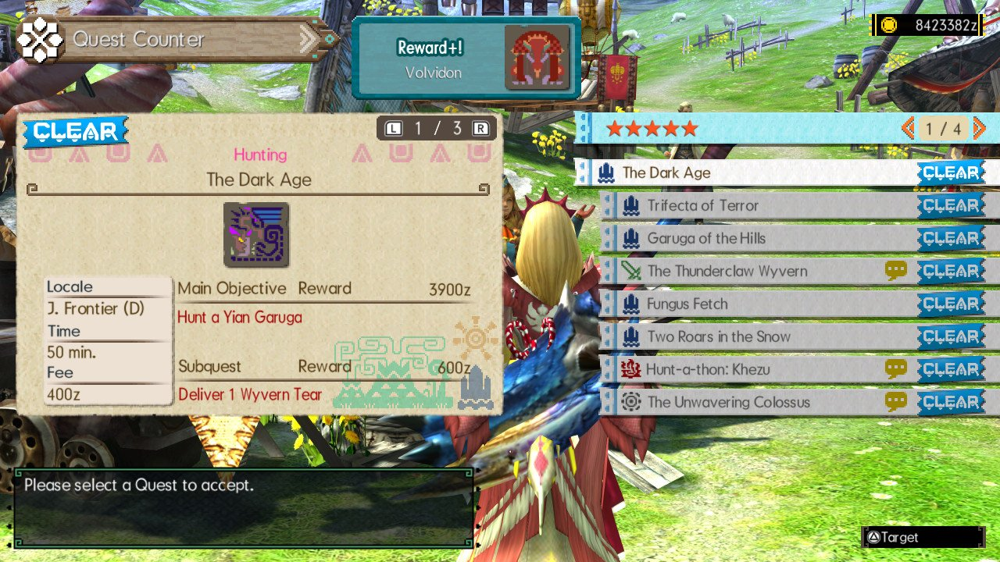</a></td>
<td width="520">
<h3><a href="mods/xx-quest-clear-icon/README.md">XX Quest Clear Icon</a> 🟢</h3>
<b>Author:</b> ishiki<br>
<b>Download:</b> <a href="https://gamebanana.com/mods/410805">GameBanana</a><br>
<b>Requires <a href="mods/forge/README.md">Forge</a>:</b> No<br>
<b>Tested recomp version:</b> 0.10.7<br>
<b>Tested platform:</b> Linux<br>
<a href="mods/xx-quest-clear-icon/README.md">Install steps and details</a>
</td>
</tr>
</table>

</div>
<!-- mods:end -->

<h2 align="center">Cheats</h2>

<p align="center">
<a href="../../issues/new?template=submit-cheat.yml"></a>
</p>

Cheats tested with MHGU Recomp. **Installing a cheat:** add the cheat's text to your cheat file. This is the same for every cheat.

**Please use cheats responsibly.** They're meant for single-player, or for multiplayer where everyone in the session has agreed to them. Don't use them to spoil other people's games.

<!-- cheats:start -->

<details>
<summary><b>(Hold L3) Hunter Speed x2</b></summary>

<b>What it does:</b> increases movement speed after pressing L3<br>
<b>Tested recomp version:</b> 0.13.1<br>
<b>Tested platform:</b> Linux


```text
[(Hold L3) Hunter Speed x2]
80000010
54000000 02126F48
54001000 00000058
78000000 000014B0
64000000 00000000 40000000
20000000
```

</details>

<details>
<summary><b>(Hold L3) Hunter Speed x5</b></summary>

<b>What it does:</b> Increases movement speed after pressing L3<br>
<b>Tested recomp version:</b> 0.13.1<br>
<b>Tested platform:</b> Linux


```text
[(Hold L3) Hunter Speed x5]
80000010
54000000 02126F48
54001000 00000058
78000000 000014B0
64000000 00000000 40A00000
20000000
```

</details>

<details>
<summary><b>Automatically Display Map</b></summary>

<b>What it does:</b> Automatically reveals the entire map at the start of a quest.<br>
<b>Tested recomp version:</b> 0.13.1<br>
<b>Tested platform:</b> Linux


```text
[Automatically Display Map]
04000000 0061BAD0 E1A00000
```

</details>

<details>
<summary><b>Capture Guru always on</b></summary>

<b>What it does:</b> Always have the ability to see when monsters are capturable<br>
<b>Tested recomp version:</b> 0.11.8<br>
<b>Tested platform:</b> Linux


```text
[Capture Guru always on]
04000000 0061D034 E3A00001
```

</details>

<details>
<summary><b>Fast gathering x4</b></summary>

<b>What it does:</b> The hunter&#x27;s animation speed is the float at player+0x14b0 (applied every frame, reset to 1.0 when an action starts). The gather action (0x4d4544) sets it to 1.1 / 0.7 for some motions and leaves 1.0 for the rest. Here its 14 motion calls go through two small stubs after main&#x27;s .text (0x13F1E90, 0x13F1EB0) that set it to 4.0 first, and its own 1.1 / 0.7 become 4.4 / 2.8. Other actions are untouched.<br>
<b>Tested recomp version:</b> 0.10.7<br>
<b>Tested platform:</b> Linux


```text
[Fast gathering x4]
04000000 013F1E90 E52D1004
04000000 013F1E94 E3001000
04000000 013F1E98 E3441080
04000000 013F1E9C E280CB05
04000000 013F1EA0 E58C10B0
04000000 013F1EA4 E49D1004
04000000 013F1EA8 EABA3EF0
04000000 013F1EB0 E52D1004
04000000 013F1EB4 E3001000
04000000 013F1EB8 E3441080
04000000 013F1EBC E280CB05
04000000 013F1EC0 E58C10B0
04000000 013F1EC4 E49D1004
04000000 013F1EC8 EABA3EB2
04000000 002D4740 EB4475D2
04000000 002D47F4 EB4475A5
04000000 002D4828 EB447598
04000000 002D485C EB44758B
04000000 002D48AC EB447577
04000000 002D48F0 EB447566
04000000 002D4964 EB447549
04000000 002D49D8 EB44752C
04000000 002D4B90 EB4474BE
04000000 002D4704 EB4475E9
04000000 002D47B0 EB4475BE
04000000 002D487C EB44758B
04000000 002D4930 EB44755E
04000000 002D4BC0 EB4474BA
04000000 002D47C0 E3441033
04000000 002D483C E344108C
04000000 002D48C8 E344108C
04000000 002D490C E344108C
04000000 002D49C0 E344108C
```

</details>

<details>
<summary><b>Interruptable Flex on Item Usage</b></summary>

<b>What it does:</b> Allows you to interrupt the flex animation<br>
<b>Tested recomp version:</b> 0.13.1<br>
<b>Tested platform:</b> Linux


```text
[Interruptable Flex on Item Usage]
08000000 013F1E28 E2847C25 E92D50FF
08000000 013F1E30 E3500001 E1D700B6
08000000 013F1E38 E1D750BA 1A00002A
08000000 013F1E40 E2466001 E59F60B0
08000000 013F1E48 0A000003 E1550006
08000000 013F1E50 E2400001 E59F00A4
08000000 013F1E58 1A000021 E1550000
08000000 013F1E60 EBBA2799 E1A00004
08000000 013F1E68 1A00001D E3500001
08000000 013F1E70 E79F0001 E59F107C
08000000 013F1E78 E2800C6B E5900000
08000000 013F1E80 E5903108 E59020FC
08000000 013F1E88 1A000007 E1550006
08000000 013F1E90 1A00000A E3530000
08000000 013F1E98 E3110B01 E59010F4
08000000 013F1EA0 E3120A0F 1A000010
08000000 013F1EA8 EA000004 0A00000E
08000000 013F1EB0 0A00000B E3120901
08000000 013F1EB8 11A00004 E3530000
08000000 013F1EC0 E1A00004 1BBA35EC
08000000 013F1EC8 E3A02004 E5D71005
08000000 013F1ED0 E52D3008 E3A03000
08000000 013F1ED8 E28DD008 EBBB13ED
08000000 013F1EE0 EBBA43AF E1A00004
08000000 013F1EE8 E1A00004 E8BD50FF
08000000 013F1EF0 004474A0 E12FFF1E
04000000 013F1EF8 00000058
04000000 0029BD64 EB45582F
```

</details>

<details>
<summary><b>Mark Boss</b></summary>

<b>What it does:</b> Always keeps the boss paintballed.<br>
<b>Tested recomp version:</b> 0.13.1<br>
<b>Tested platform:</b> Linux


```text
[Mark Boss]
04000000 0061CC94 E3A00001
```

</details>

<details>
<summary><b>Max gathers at every spot</b></summary>

<b>What it does:</b> Gather points roll rand(32) &lt; N after each gather to run out early (N = 7 normally, 5 with Gathering +1, 3 with Gathering +2, 11 with Gathering -1). This makes N = 0, so every spot gives its full number of gathers. Patches the bl at 0x51b31c.<br>
<b>Tested recomp version:</b> 0.10.7<br>
<b>Tested platform:</b> Linux


```text
[Max gathers at every spot]
04000000 0031B31C E3A00000
```

</details>

<details>
<summary><b>Max quest rewards</b></summary>

<b>What it does:</b> The game rolls each extra reward slot as: luck &gt; rand(32). luck comes from 0x5822bc: 31 with Miraculous Luck, 28 Great, 25 Good, 22 with no luck skill, 16 / 8 for Bad / Horrible. Both reward count functions (0x581fec, 0x582e1c) ask it. This makes it always answer 32, so every roll succeeds and every reward screen gets the most slots (8).<br>
<b>Tested recomp version:</b> 0.10.7<br>
<b>Tested platform:</b> Linux


```text
04000000 003822BC E3A00020
04000000 003822C0 E12FFF1E
```

</details>

<details>
<summary><b>Skill points x2</b></summary>

<b>What it does:</b> Doubles value of skill points from armor<br>
<b>Tested recomp version:</b> 0.11.8<br>
<b>Tested platform:</b> Linux


```text
[Skill points x2]
04000000 000DFAB4 E1A00080
04000000 000DFD38 E0822080
04000000 000DFD44 E0820080
04000000 000E024C E0822080
04000000 000E0258 E0820080
```

</details>

<!-- cheats:end -->

<h2 align="center">Adding a mod</h2>

See [CONTRIBUTING.md](CONTRIBUTING.md). Use [TEMPLATE.md](TEMPLATE.md) for a mod's page.

<h2 align="center">License</h2>

The list itself is released under [CC0 1.0](LICENSE). Every linked mod is the work of its author and keeps its own license.
