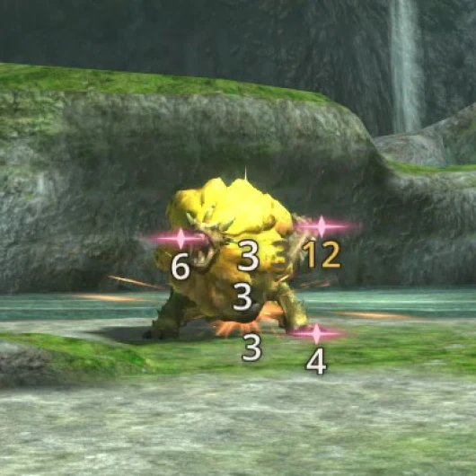
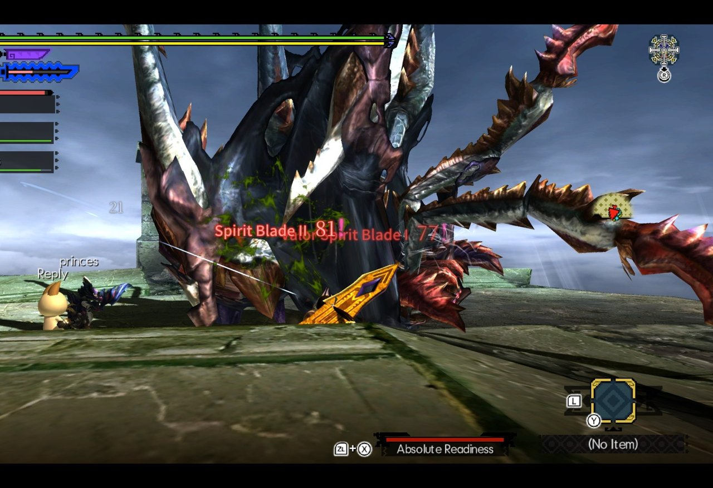
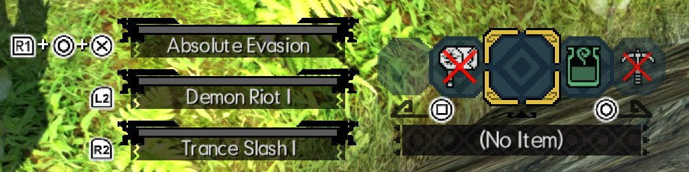
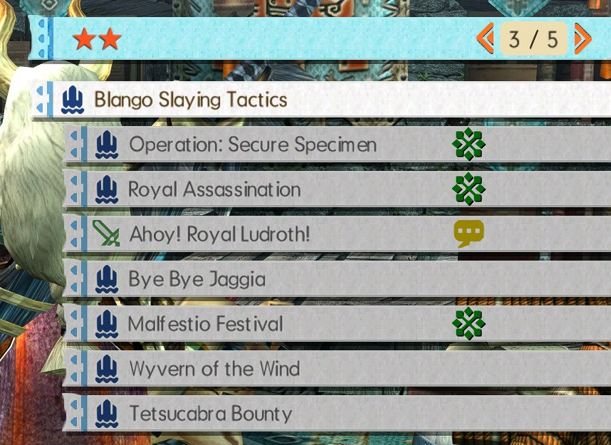
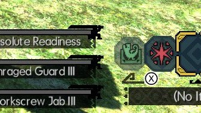

<h1 align="center">MHGURecomp-mods</h1>

<p align="center">
<a href="https://github.com/morerokk/MHGURecomp/releases/latest"></a>
<a href="CONTRIBUTING.md"></a>
<a href="https://github.com/morerokk/MHGURecomp"></a>
<a href="LICENSE"></a>
</p>

<p align="center">
A curated directory of mods tested with <a href="https://github.com/morerokk/MHGURecomp">MHGU Recomp</a>, with links to each mod's download page, install steps, and the versions and platforms they've been tested on.<br>
This repository only holds links and notes. No mod files are hosted here: download each mod from the page its author published it on.
</p>

<h2 align="center">Mod list</h2>

<h3 align="center">Compatibility status</h3>

| Status | Meaning |
| :---: | :--- |
| 🟢 | Full compatibility: everything the mod does works with the recomp. |
| 🟡 | Partial: the mod loads, but some of its features are missing or broken. |
| 🔴 | Broken: the mod doesn't work, or crashes the game. |

<h3 align="center">Mods</h3>

<div align="center">

<table>
<tr>
<td align="center" width="380"></td>
<td width="520">
<h3><a href="mods/better-inputs/README.md">Better Inputs</a> 🟢</h3>
<b>Author:</b> Fexty12573<br>
<b>Download:</b> <a href="https://gamebanana.com/mods/689270">GameBanana</a><br>
<b>Tested recomp version:</b> TBD<br>
<b>Tested platform:</b> Linux<br>
<a href="mods/better-inputs/README.md">Install steps and details</a>
</td>
</tr>
</table>

<table>
<tr>
<td align="center" width="380"></td>
<td width="520">
<h3><a href="mods/damage-numbers/README.md">Damage Numbers</a> 🟢</h3>
<b>Author:</b> PurplefinNeptuna<br>
<b>Download:</b> <a href="https://gamebanana.com/mods/725408">GameBanana</a><br>
<b>Tested recomp version:</b> TBD<br>
<b>Tested platform:</b> Linux<br>
<a href="mods/damage-numbers/README.md">Install steps and details</a>
</td>
</tr>
</table>

<table>
<tr>
<td align="center" width="380"></td>
<td width="520">
<h3><a href="mods/ff14-damage-text/README.md">FF14-style Damage Text</a> 🟢</h3>
<b>Author:</b> Filianore<br>
<b>Download:</b> <a href="https://gamebanana.com/mods/727751">GameBanana</a><br>
<b>Tested recomp version:</b> TBD<br>
<b>Tested platform:</b> Linux<br>
<a href="mods/ff14-damage-text/README.md">Install steps and details</a>
</td>
</tr>
</table>

<table>
<tr>
<td align="center" width="380"><sub>No preview yet</sub></td>
<td width="520">
<h3><a href="mods/forge/README.md">forge</a> 🟢</h3>
<b>Author:</b> Fexty12573<br>
<b>Download:</b> <a href="https://github.com/Fexty12573/forge">GitHub</a><br>
<b>Tested recomp version:</b> 0.9.1.0<br>
<b>Tested platform:</b> Linux<br>
<a href="mods/forge/README.md">Install steps and details</a>
</td>
</tr>
</table>

<table>
<tr>
<td align="center" width="380"></td>
<td width="520">
<h3><a href="mods/dualshock-buttons/README.md">Full DualShock Buttons</a> 🟢</h3>
<b>Author:</b> Abbanon<br>
<b>Download:</b> <a href="https://gamebanana.com/mods/475878">GameBanana</a><br>
<b>Tested recomp version:</b> TBD<br>
<b>Tested platform:</b> Linux<br>
<a href="mods/dualshock-buttons/README.md">Install steps and details</a>
</td>
</tr>
</table>

<table>
<tr>
<td align="center" width="380"></td>
<td width="520">
<h3><a href="mods/key-quest-markers/README.md">Key Quest Markers</a> 🟢</h3>
<b>Author:</b> PurplefinNeptuna<br>
<b>Download:</b> <a href="https://gamebanana.com/mods/727960">GameBanana</a><br>
<b>Tested recomp version:</b> TBD<br>
<b>Tested platform:</b> Linux<br>
<a href="mods/key-quest-markers/README.md">Install steps and details</a>
</td>
</tr>
</table>

<table>
<tr>
<td align="center" width="380"></td>
<td width="520">
<h3><a href="mods/weakness-icons/README.md">Monster Weakness Icons</a> 🟢</h3>
<b>Author:</b> Potobc<br>
<b>Download:</b> <a href="https://gamebanana.com/mods/488552">GameBanana</a><br>
<b>Tested recomp version:</b> TBD<br>
<b>Tested platform:</b> Linux<br>
<a href="mods/weakness-icons/README.md">Install steps and details</a>
</td>
</tr>
</table>

<table>
<tr>
<td align="center" width="380"></td>
<td width="520">
<h3><a href="mods/xbox-layout/README.md">Xbox Controller Layout</a> 🟢</h3>
<b>Author:</b> ishiki<br>
<b>Download:</b> <a href="https://gamebanana.com/mods/410801">GameBanana</a><br>
<b>Tested recomp version:</b> TBD<br>
<b>Tested platform:</b> Linux<br>
<a href="mods/xbox-layout/README.md">Install steps and details</a>
</td>
</tr>
</table>

</div>

## Installing mods

MHGU Recomp loads mods from a `mods` folder next to the recomp executable. Each mod gets its own folder:

```
mods/
└── <mod-name>/
    ├── romfs/   # replacement game data files
    └── exefs/   # exefs patches
```

Most mods only use one of the two folders. If a mod was packaged for an emulator (for example Yuzu or Ryujinx `romfs`/`exefs` layout), copy those folders into `mods/<mod-name>/`. Check the mod's page here for anything specific to it.

## Adding a mod

See [CONTRIBUTING.md](CONTRIBUTING.md). Use [TEMPLATE.md](TEMPLATE.md) for a mod's page.

## License

The list itself is released under [CC0 1.0](LICENSE). Every linked mod is the work of its author and keeps its own license.
