<h1 align="center">MHGURecomp-mods</h1>

<p align="center">
<a href="https://github.com/morerokk/MHGURecomp/releases/latest"></a>
<a href="https://github.com/morerokk/MHGURecomp"></a>
</p>

<p align="center">
<b>A curated directory of mods tested with <a href="https://github.com/morerokk/MHGURecomp">MHGU Recomp</a></b><br>
Each entry links to the mod's download page, with install steps<br>
and the versions and platforms it has been tested on.
</p>

<p align="center">
<sub>No mod files are hosted here, only links. Download each mod from its author's page.</sub>
</p>

<h2 align="center">Installing mods</h2>

<p align="center">Every mod here is for MHGU 1.4.0, the game's final update, which MHGU Recomp requires.<br>
MHGU Recomp loads mods from a <code>mods</code> folder next to the recomp executable.<br>
Each mod gets its own folder:</p>

<div align="center">

```
mods/
└── <mod-name>/
    ├── romfs/   # replacement game data files
    └── exefs/   # exefs patches
```

</div>

<p align="center">Most mods only use one of the two folders. If a mod was packaged for an emulator<br>
(for example a Yuzu or Ryujinx <code>romfs</code>/<code>exefs</code> layout), copy those folders into <code>mods/&lt;mod-name&gt;/</code>.<br>
Check the mod's page here for anything specific to it.</p>

<h2 align="center">Mod list</h2>

<p align="center">
<a href="CONTRIBUTING.md"></a>
<a href="../../issues/new?template=report-mod-issue.yml"></a>
</p>

<h3 align="center">Compatibility status</h3>

<div align="center">

<table>
<tr><th>Status</th><th>Meaning</th></tr>
<tr><td align="center">🟢</td><td>Full compatibility: everything the mod does works with the recomp.</td></tr>
<tr><td align="center">🟡</td><td>Partial: the mod loads, but some of its features are missing or broken.</td></tr>
<tr><td align="center">🔴</td><td>Broken: the mod doesn't work, or crashes the game.</td></tr>
</table>

</div>

<h3 align="center">Dependencies</h3>

<p align="center">These aren't mods you play with on their own, but many of the mods below need them. Install them first.<br>
Each mod card says whether it requires Forge.</p>

<div align="center">

<table>
<tr>
<td align="center" width="380"><a href="mods/forge/preview.jpg">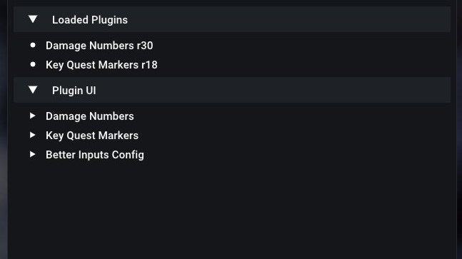</a></td>
<td width="520">
<h3><a href="mods/forge/README.md">Forge</a> 🟢</h3>
<b>Author:</b> Fexty12573<br>
<b>Download:</b> <a href="https://github.com/Fexty12573/forge">GitHub</a><br>
<b>Tested recomp version:</b> 0.9.1.0<br>
<b>Tested platform:</b> Linux<br>
<a href="mods/forge/README.md">Install steps and details</a>
</td>
</tr>
</table>

<table>
<tr>
<td align="center" width="380"><a href="mods/katlib/preview.jpg"></a></td>
<td width="520">
<h3><a href="mods/katlib/README.md">KatLib</a> 🟢</h3>
<b>Author:</b> Katt404<br>
<b>Download:</b> <a href="https://gamebanana.com/mods/732712">GameBanana</a><br>
<b>Requires <a href="mods/forge/README.md">Forge</a>:</b> Yes<br>
<b>Tested recomp version:</b> TBD<br>
<b>Tested platform:</b> Linux<br>
<a href="mods/katlib/README.md">Install steps and details</a>
</td>
</tr>
</table>

</div>

<h3 align="center">Mods</h3>

<!-- mods:start -->
<div align="center">

<table>
<tr>
<td align="center" width="380"><a href="mods/better-inputs/preview.jpg">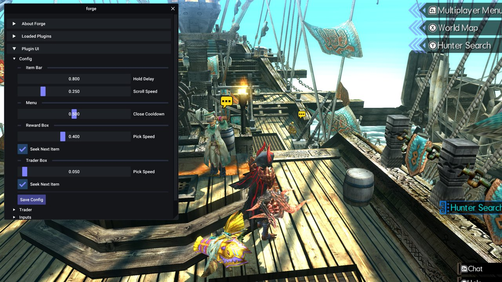</a></td>
<td width="520">
<h3><a href="mods/better-inputs/README.md">Better Inputs</a> 🟢</h3>
<b>Author:</b> Fexty12573<br>
<b>Download:</b> <a href="https://gamebanana.com/mods/689270">GameBanana</a><br>
<b>Requires <a href="mods/forge/README.md">Forge</a>:</b> Yes (1.4.0 or newer)<br>
<b>Tested recomp version:</b> TBD<br>
<b>Tested platform:</b> Linux<br>
<a href="mods/better-inputs/README.md">Install steps and details</a>
</td>
</tr>
</table>

<table>
<tr>
<td align="center" width="380"><a href="mods/damage-numbers/preview.jpg">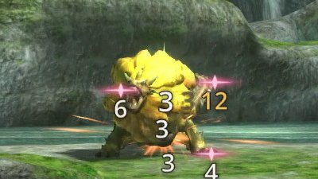</a></td>
<td width="520">
<h3><a href="mods/damage-numbers/README.md">Damage Numbers</a> 🟢</h3>
<b>Author:</b> PurplefinNeptuna<br>
<b>Download:</b> <a href="https://gamebanana.com/mods/725408">GameBanana</a><br>
<b>Requires <a href="mods/forge/README.md">Forge</a>:</b> Yes (1.4.1)<br>
<b>Tested recomp version:</b> TBD<br>
<b>Tested platform:</b> Linux<br>
<a href="mods/damage-numbers/README.md">Install steps and details</a>
</td>
</tr>
</table>

<table>
<tr>
<td align="center" width="380"><a href="mods/ff14-damage-text/preview.jpg">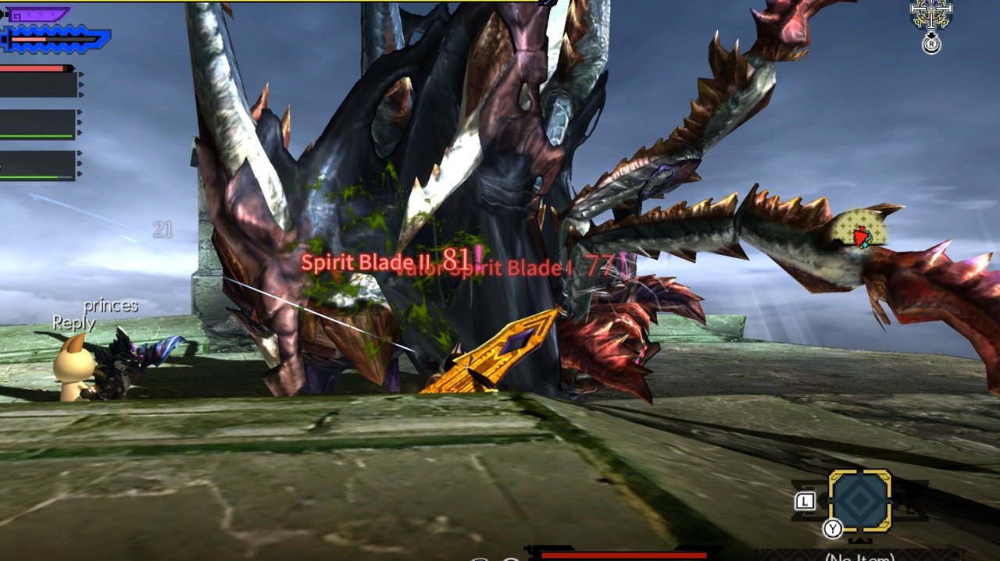</a></td>
<td width="520">
<h3><a href="mods/ff14-damage-text/README.md">FF14-style Damage Text</a> 🟢</h3>
<b>Author:</b> Filianore<br>
<b>Download:</b> <a href="https://gamebanana.com/mods/727751">GameBanana</a><br>
<b>Requires <a href="mods/forge/README.md">Forge</a>:</b> Yes (1.4.1)<br>
<b>Tested recomp version:</b> TBD<br>
<b>Tested platform:</b> Linux<br>
<a href="mods/ff14-damage-text/README.md">Install steps and details</a>
</td>
</tr>
</table>

<table>
<tr>
<td align="center" width="380"><a href="mods/dualshock-buttons/preview.jpg">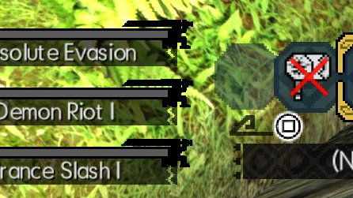</a></td>
<td width="520">
<h3><a href="mods/dualshock-buttons/README.md">Full DualShock Buttons</a> 🟢</h3>
<b>Author:</b> Abbanon<br>
<b>Download:</b> <a href="https://gamebanana.com/mods/475878">GameBanana</a><br>
<b>Requires <a href="mods/forge/README.md">Forge</a>:</b> No<br>
<b>Tested recomp version:</b> TBD<br>
<b>Tested platform:</b> Linux<br>
<a href="mods/dualshock-buttons/README.md">Install steps and details</a>
</td>
</tr>
</table>

<table>
<tr>
<td align="center" width="380"><a href="mods/key-quest-markers/preview.jpg">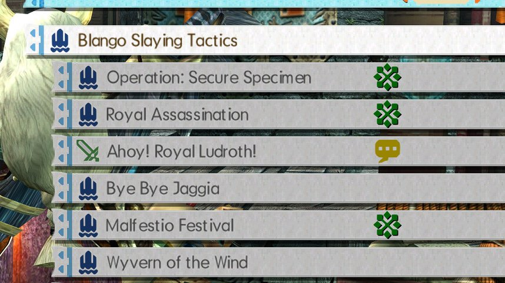</a></td>
<td width="520">
<h3><a href="mods/key-quest-markers/README.md">Key Quest Markers</a> 🟢</h3>
<b>Author:</b> PurplefinNeptuna<br>
<b>Download:</b> <a href="https://gamebanana.com/mods/727960">GameBanana</a><br>
<b>Requires <a href="mods/forge/README.md">Forge</a>:</b> Yes (1.5.1)<br>
<b>Tested recomp version:</b> TBD<br>
<b>Tested platform:</b> Linux<br>
<a href="mods/key-quest-markers/README.md">Install steps and details</a>
</td>
</tr>
</table>

<table>
<tr>
<td align="center" width="380"><a href="mods/mapassist-monster-icons-on-the-map/preview.jpg">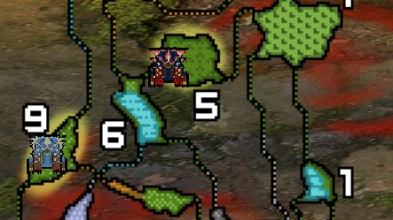</a></td>
<td width="520">
<h3><a href="mods/mapassist-monster-icons-on-the-map/README.md">MapAssist - Monster Icons on the Map</a> 🟢</h3>
<b>Author:</b> Katt404<br>
<b>Download:</b> <a href="https://gamebanana.com/mods/732716">GameBanana</a><br>
<b>Requires <a href="mods/forge/README.md">Forge</a>:</b> Yes<br>
<b>Tested recomp version:</b> 0.10.7<br>
<b>Tested platform:</b> Linux<br>
<a href="mods/mapassist-monster-icons-on-the-map/README.md">Install steps and details</a>
</td>
</tr>
</table>

<table>
<tr>
<td align="center" width="380"><a href="mods/mhgu-hd-project/preview.jpg">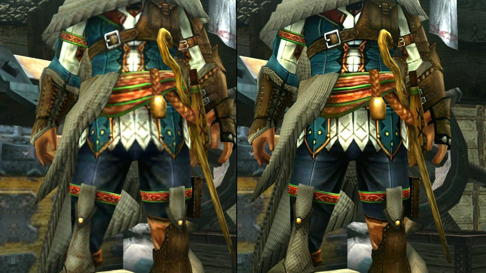</a></td>
<td width="520">
<h3><a href="mods/mhgu-hd-project/README.md">MHGU HD Project</a> 🟢</h3>
<b>Author:</b> Monkbreh<br>
<b>Download:</b> <a href="https://github.com/Monkbreh/MHGU-HD-Project">GitHub</a><br>
<b>Requires <a href="mods/forge/README.md">Forge</a>:</b> No<br>
<b>Tested recomp version:</b> 0.10.7<br>
<b>Tested platform:</b> Linux<br>
<a href="mods/mhgu-hd-project/README.md">Install steps and details</a>
</td>
</tr>
</table>

<table>
<tr>
<td align="center" width="380"><a href="mods/mhgu-xx-rebalanced/preview.jpg">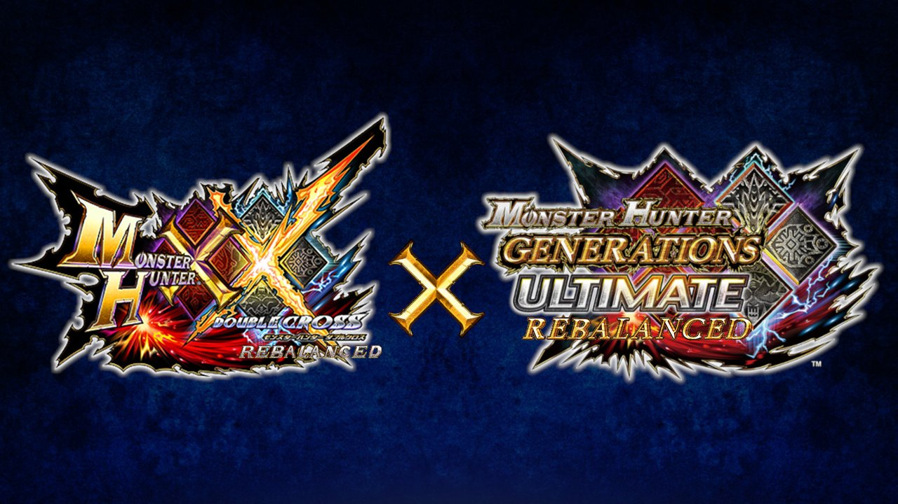</a></td>
<td width="520">
<h3><a href="mods/mhgu-xx-rebalanced/README.md">MHGU/XX Rebalanced</a> 🟢</h3>
<b>Author:</b> Potobc<br>
<b>Download:</b> <a href="https://gamebanana.com/mods/447835">GameBanana</a><br>
<b>Requires <a href="mods/forge/README.md">Forge</a>:</b> No<br>
<b>Tested recomp version:</b> 0.9.1.0<br>
<b>Tested platform:</b> Linux<br>
<a href="mods/mhgu-xx-rebalanced/README.md">Install steps and details</a>
</td>
</tr>
</table>

<table>
<tr>
<td align="center" width="380"><a href="mods/weakness-icons/preview.jpg">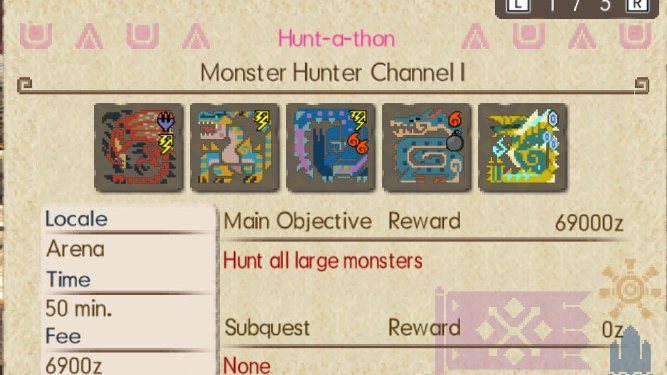</a></td>
<td width="520">
<h3><a href="mods/weakness-icons/README.md">Monster Weakness Icons</a> 🟢</h3>
<b>Author:</b> Potobc<br>
<b>Download:</b> <a href="https://gamebanana.com/mods/488552">GameBanana</a><br>
<b>Requires <a href="mods/forge/README.md">Forge</a>:</b> No<br>
<b>Tested recomp version:</b> TBD<br>
<b>Tested platform:</b> Linux<br>
<a href="mods/weakness-icons/README.md">Install steps and details</a>
</td>
</tr>
</table>

<table>
<tr>
<td align="center" width="380"><a href="mods/uiscale-hud-scale-and-layout-editor/preview.jpg">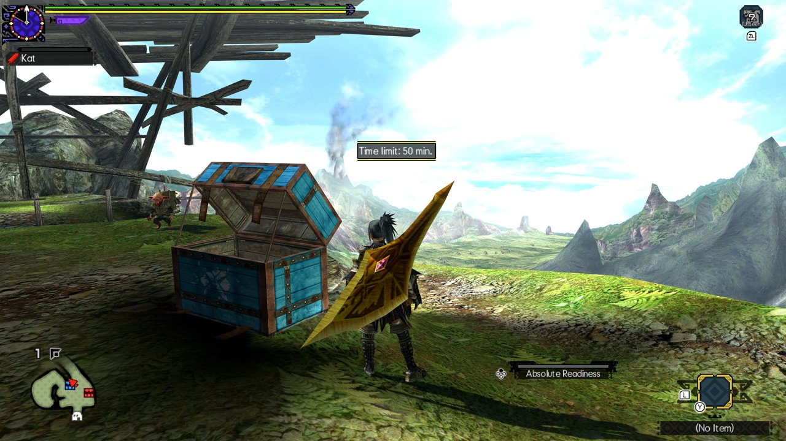</a></td>
<td width="520">
<h3><a href="mods/uiscale-hud-scale-and-layout-editor/README.md">UIScale - HUD Scale and Layout Editor</a> 🟢</h3>
<b>Author:</b> Katt404<br>
<b>Download:</b> <a href="https://gamebanana.com/mods/732711">GameBanana</a><br>
<b>Requires <a href="mods/forge/README.md">Forge</a>:</b> Yes<br>
<b>Tested recomp version:</b> 0.10.7<br>
<b>Tested platform:</b> Linux<br>
<a href="mods/uiscale-hud-scale-and-layout-editor/README.md">Install steps and details</a>
</td>
</tr>
</table>

<table>
<tr>
<td align="center" width="380"><a href="mods/xbox-layout/preview.jpg">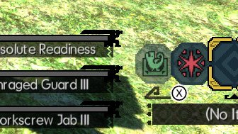</a></td>
<td width="520">
<h3><a href="mods/xbox-layout/README.md">Xbox Controller Layout</a> 🟢</h3>
<b>Author:</b> ishiki<br>
<b>Download:</b> <a href="https://gamebanana.com/mods/410801">GameBanana</a><br>
<b>Requires <a href="mods/forge/README.md">Forge</a>:</b> No<br>
<b>Tested recomp version:</b> TBD<br>
<b>Tested platform:</b> Linux<br>
<a href="mods/xbox-layout/README.md">Install steps and details</a>
</td>
</tr>
</table>

</div>
<!-- mods:end -->

<h2 align="center">Cheats</h2>

<p align="center">
<a href="../../issues/new?template=submit-cheat.yml"></a>
</p>

<p align="center">Cheats tested with MHGU Recomp.<br>
<b>Installing a cheat:</b> add the cheat's text to your cheat file. This is the same for every cheat.</p>

<p align="center"><b>Please use cheats responsibly.</b> They're meant for single-player,<br>
or for multiplayer where everyone in the session has agreed to them.<br>
Don't use them to spoil other people's games.</p>

<!-- cheats:start -->

<details>
<summary><b>Fast gathering x4</b></summary>

<b>What it does:</b> The hunter&#x27;s animation speed is the float at player+0x14b0 (applied every frame, reset to 1.0 when an action starts). The gather action (0x4d4544) sets it to 1.1 / 0.7 for some motions and leaves 1.0 for the rest. Here its 14 motion calls go through two small stubs after main&#x27;s .text (0x13F1E90, 0x13F1EB0) that set it to 4.0 first, and its own 1.1 / 0.7 become 4.4 / 2.8. Other actions are untouched.<br>
<b>Tested recomp version:</b> 0.10.7<br>
<b>Tested platform:</b> Linux


```text
[Fast gathering x4]
04000000 013F1E90 E52D1004
04000000 013F1E94 E3001000
04000000 013F1E98 E3441080
04000000 013F1E9C E280CB05
04000000 013F1EA0 E58C10B0
04000000 013F1EA4 E49D1004
04000000 013F1EA8 EABA3EF0
04000000 013F1EB0 E52D1004
04000000 013F1EB4 E3001000
04000000 013F1EB8 E3441080
04000000 013F1EBC E280CB05
04000000 013F1EC0 E58C10B0
04000000 013F1EC4 E49D1004
04000000 013F1EC8 EABA3EB2
04000000 002D4740 EB4475D2
04000000 002D47F4 EB4475A5
04000000 002D4828 EB447598
04000000 002D485C EB44758B
04000000 002D48AC EB447577
04000000 002D48F0 EB447566
04000000 002D4964 EB447549
04000000 002D49D8 EB44752C
04000000 002D4B90 EB4474BE
04000000 002D4704 EB4475E9
04000000 002D47B0 EB4475BE
04000000 002D487C EB44758B
04000000 002D4930 EB44755E
04000000 002D4BC0 EB4474BA
04000000 002D47C0 E3441033
04000000 002D483C E344108C
04000000 002D48C8 E344108C
04000000 002D490C E344108C
04000000 002D49C0 E344108C
```

</details>

<details>
<summary><b>Max gathers at every spot</b></summary>

<b>What it does:</b> Gather points roll rand(32) &lt; N after each gather to run out early (N = 7 normally, 5 with Gathering +1, 3 with Gathering +2, 11 with Gathering -1). This makes N = 0, so every spot gives its full number of gathers. Patches the bl at 0x51b31c.<br>
<b>Tested recomp version:</b> 0.10.7<br>
<b>Tested platform:</b> Linux


```text
[Max gathers at every spot]
04000000 0031B31C E3A00000
```

</details>

<details>
<summary><b>Max quest rewards</b></summary>

<b>What it does:</b> The game rolls each extra reward slot as: luck &gt; rand(32). luck comes from 0x5822bc: 31 with Miraculous Luck, 28 Great, 25 Good, 22 with no luck skill, 16 / 8 for Bad / Horrible. Both reward count functions (0x581fec, 0x582e1c) ask it. This makes it always answer 32, so every roll succeeds and every reward screen gets the most slots (8).<br>
<b>Tested recomp version:</b> 0.107<br>
<b>Tested platform:</b> Linux


```text
04000000 003822BC E3A00020
04000000 003822C0 E12FFF1E
```

</details>

<!-- cheats:end -->

<h2 align="center">Adding a mod</h2>

<p align="center">See <a href="CONTRIBUTING.md">CONTRIBUTING.md</a>. Use <a href="TEMPLATE.md">TEMPLATE.md</a> for a mod's page.</p>

<h2 align="center">License</h2>

<p align="center">The list itself is released under <a href="LICENSE">CC0 1.0</a>.<br>
Every linked mod is the work of its author and keeps its own license.</p>
