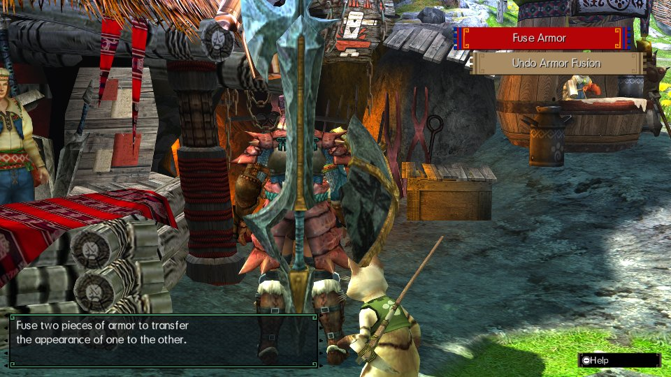

# Armor Fusion

- **Author:** [Rikiar73574](https://github.com/Rikiar73574)
- **Download:** [GitHub v0.1.0](https://github.com/Rikiar73574/mhgu-armor-fusion/releases/tag/v0.1.0)
- **Mod license:** MIT; includes the Forge-RS MIT notice.
- **Requires [Forge](../forge/README.md):** Yes (1.5.1, built into the tested Recomp executable)
- **Status:** 🟢 Full compatibility on the tested configuration below

## Description

Unlocks native Armor Fusion at every forge from the start, transferring armor appearances while keeping the base piece's stats and decorations. Pieces must match body slot and LR/HR/G rank; fusion uses monster-material points and supports undo.

## Tested with

| Recomp version | Tested platform |
| --- | --- |
| Stock source build [`a272b61`](https://github.com/morerokk/MHGURecomp/commit/a272b61) | Linux |

The tested executable reports `0.15.0-stock-a272b61` and has no built-in Armor Fusion. With MHGU 1.4, native paid fusion, separation, decorations and Save/cold reload passed, alongside a seven-NRO installed stack and an actual local shared quest with an unmodded peer. Other platforms, mod stacks and every armor combination are not covered.

## Install

1. Download the release from the link above.
2. Create `mods/armor-fusion/` in your MHGU Recomp folder.
3. Copy the release's `romfs` folder into it, producing `mods/armor-fusion/romfs/nativeNX/plugins/armor_fusion.nro`.
4. Enable the mod and restart MHGURecomp. Use a stock executable without built-in Armor Fusion; never enable both implementations.

## Known issues

- Caller-sensitive hooks require untouched stock entries; plugins patching those functions are unsupported.
- All loaded NROs share Forge's 12 MiB plugin region.
- When using Hunter's Compendium, install its [current release](https://github.com/Rikiar73574/mhgu-compendium/releases/latest), which includes the smithy-hook compatibility change.
