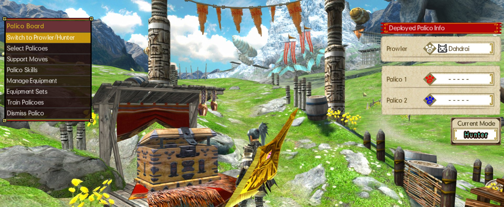

# Better Box

- **Author:** Katt404
- **Download:** [GameBanana](https://gamebanana.com/mods/732709)
- **Requires [Forge](../forge/README.md):** Yes (1.5.1)
- **Mod license:** see the mod's GameBanana page
- **Status:** 🟢 Full compatibility

## Description

See the [GameBanana page](https://gamebanana.com/mods/732709) for what this mod does.

## Tested with

| Recomp version | Tested platform |
| --- | --- |
| 0.17.5 | Windows |

## Install

1. Download the mod from the link above.
2. Create `mods/better-box/` in your MHGU Recomp folder.
3. Copy the mod's `romfs` and/or `exefs` folders into `mods/better-box/`.

## Known issues

- Odd camera rotation may appear in bases (cosmetic).
- Untested on Switch.
