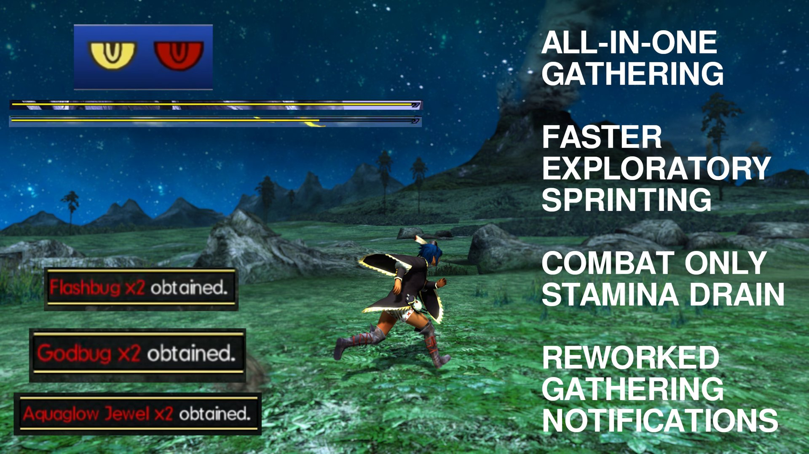

# Faster Field Hunter

- **Author:** Ellipse1638
- **Download:** [GameBanana](https://gamebanana.com/mods/735791)
- **Requires [Forge](../forge/README.md):** Yes (1.0+)
- **Mod license:** see the mod's GameBanana page
- **Status:** 🟢 Full compatibility

## Description

See the [GameBanana page](https://gamebanana.com/mods/735791) for what this mod does.

## Tested with

| Recomp version | Tested platform |
| --- | --- |
| 0.13.1 | Linux |

## Install

1. Download the mod from the link above.
2. Create `mods/faster-field-hunter/` in your MHGU Recomp folder.
3. Copy the mod's `romfs` and/or `exefs` folders into `mods/faster-field-hunter/`.

## Known issues

None known.
