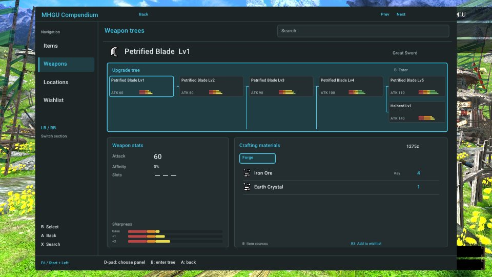

# Hunter's Compendium

- **Author:** [Rikiar73574](https://github.com/Rikiar73574)
- **Download:** [v0.2.0](https://github.com/Rikiar73574/mhgu-compendium/releases/tag/v0.2.0)
- **Mod license:** [MIT](https://github.com/Rikiar73574/mhgu-compendium/blob/main/LICENSE) for authored code. Third-party content and game assets retain their ownership and notices; see [runtime notices](https://github.com/Rikiar73574/mhgu-compendium/blob/main/RUNTIME_NOTICES.md).
- **Requires [Forge](../forge/README.md):** Yes (1.5.1, built into the tested MHGURecomp build).
- **Status:** 🟢 Full compatibility

## Description

Browse items, weapon upgrade trees, crafting materials and gathering sources without leaving the game. Includes controller search, direct material-source links, a persistent recipe wishlist with owned-material counts, and a passive quest material tracker.

## Tested with

| Recomp version | Tested platform |
| --- | --- |
| Stock source build [`a272b61`](https://github.com/morerokk/MHGURecomp/commit/a272b61) | Linux |

Tested with MHGU 1.4.0 English data. The complete installed stack loaded all seven NROs, including Armor Fusion; live checks covered the browser UI, weapon trees/details, material sources, grouped gathering, controller search, wishlist addition/persistence, and the passive quest HUD. See the [validation record](https://github.com/Rikiar73574/mhgu-compendium/blob/main/docs/validation.md).

## Install

1. Download v0.2.0 from the link above.
2. Create `mods/hunters-compendium/` in your MHGU Recomp folder and copy the release's `romfs` folder into it.
3. Confirm there is exactly one Compendium NRO at `mods/hunters-compendium/romfs/nativeNX/plugins/hunters_compendium.nro`; remove duplicate copies under other names.
4. Enable Hunter's Compendium in Recomp and restart Recomp.

## Controls

- **Start + D-pad Left:** open/close (keyboard: **F6**).
- **Xbox B:** select; **Xbox A:** back; **LB/RB:** switch section.
- **X:** controller search; desktop typing also searches.
- **R3:** add/remove a recipe from the wishlist, including supported native smithy upgrade screens.

## Known issues

None known in the exercised Linux behavior. Validation limits:

- All NRO plugins share Recomp's **12 MiB** plugin memory region; very large combinations may exceed it. The tested seven-NRO stack fit with loader headroom.
- Windows, Android, console and other plugin combinations are unverified.
- Gathering-driven tracker count reduction and quest completion were not established by the recorded live tests.
