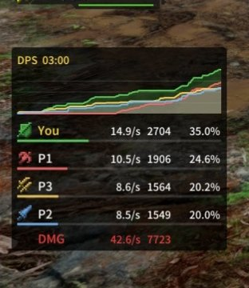

# MHGU DPS Meter

- **Author:** sadgnk169
- **Download:** [GitHub](https://github.com/sadgnk169/MHGU-DPS-Meter)
- **Requires [Forge](../forge/README.md):** Yes
- **Mod license:** see the mod's GitHub page
- **Status:** 🟡 Some features missing

## Description

See the [GitHub page](https://github.com/sadgnk169/MHGU-DPS-Meter) for what this mod does.

## Tested with

| Recomp version | Tested platform |
| --- | --- |
| 0.11.2 | Linux |

## Install

1. Download the mod from the link above.
2. Create `mods/mhgu-dps-meter/` in your MHGU Recomp folder.
3. Copy the mod's `romfs` and/or `exefs` folders into `mods/mhgu-dps-meter/`.

## Known issues

Has a minor UI issue but functions.
