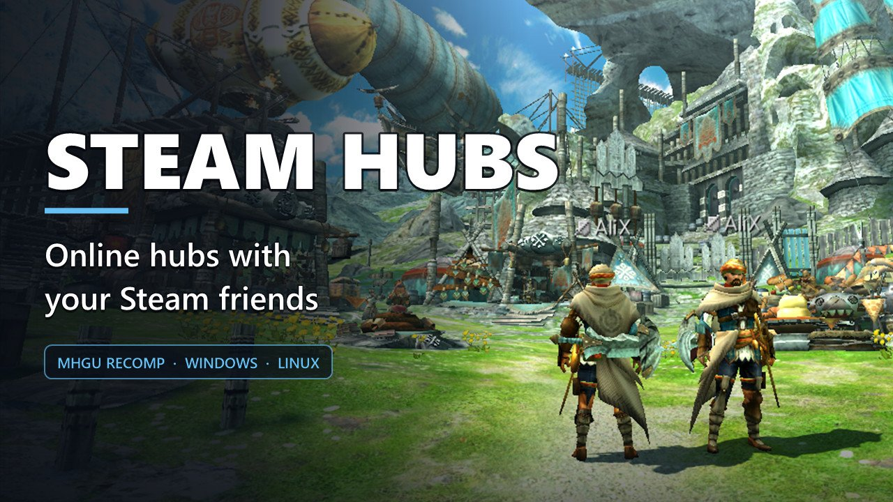

# Steam Integration

- **Author:** Alixknd
- **Download:** [GameBanana](https://gamebanana.com/mods/740273)
- **Requires [Forge](../forge/README.md):** No
- **Mod license:** see the mod's GameBanana page
- **Status:** 🟢 Full compatibility

## Description

See the [GameBanana page](https://gamebanana.com/mods/740273) for what this mod does.

## Tested with

| Recomp version | Tested platform |
| --- | --- |
| .17.5 | Linux |

## Install

1. Download the mod from the link above.
2. Create `mods/steam-integration/` in your MHGU Recomp folder.
3. Copy the mod's `romfs` and/or `exefs` folders into `mods/steam-integration/`.

## Known issues

None known.
