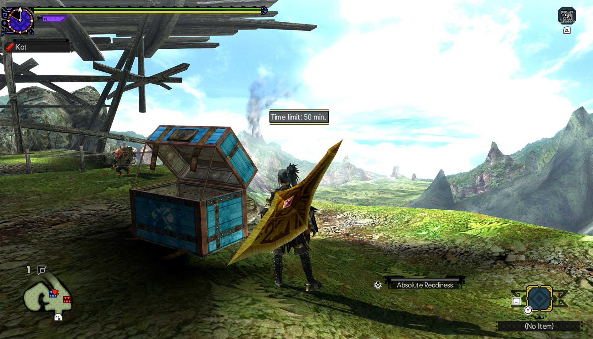

# UIScale - HUD Scale and Layout Editor

- **Author:** Katt404
- **Download:** [GameBanana](https://gamebanana.com/mods/732711)
- **Requires [Forge](../forge/README.md):** Yes
- **Mod license:** see the mod's GameBanana page
- **Status:** 🟢 Full compatibility

## Description

See the [GameBanana page](https://gamebanana.com/mods/732711) for what this mod does.

## Tested with

| Recomp version | Tested platform |
| --- | --- |
| 0.10.7 | Linux |

## Install

1. Download the mod from the link above.
2. Create `mods/uiscale-hud-scale-and-layout-editor/` in your MHGU Recomp folder.
3. Copy the mod's `romfs` and/or `exefs` folders into `mods/uiscale-hud-scale-and-layout-editor/`.

## Known issues

None known.
