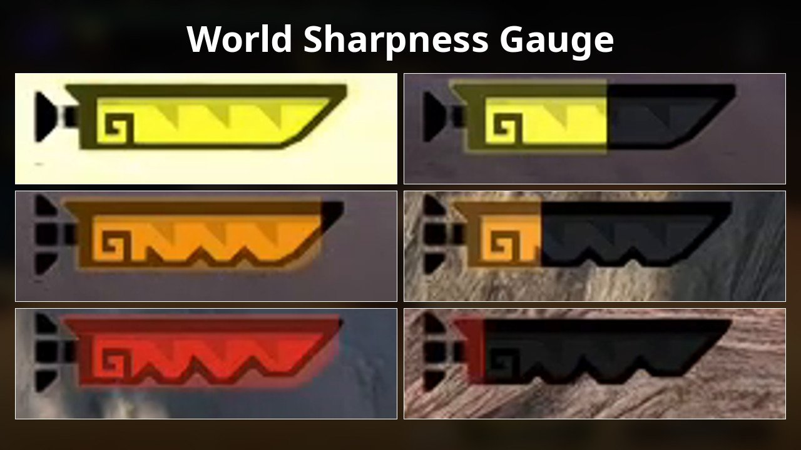

# World(like) Sharpness Gauge

- **Author:** PurplefinNeptuna
- **Download:** [GameBanana](https://gamebanana.com/mods/735541)
- **Requires [Forge](../forge/README.md):** Yes (1.5.1)
- **Mod license:** see the mod's GameBanana page
- **Status:** 🟢 Full compatibility

## Description

See the [GameBanana page](https://gamebanana.com/mods/735541) for what this mod does.

## Tested with

| Recomp version | Tested platform |
| --- | --- |
| 0.13.1 | Linux |

## Install

1. Download the mod from the link above.
2. Create `mods/world-like-sharpness-gauge/` in your MHGU Recomp folder.
3. Copy the mod's `romfs` and/or `exefs` folders into `mods/world-like-sharpness-gauge/`.

## Known issues

Can conflict with Kat Library Tool (https://github.com/Oddity-git/MHGURecomp-mods/blob/main/mods/katlib/README.md) that is required for mods like the UI Scaler. 

To ensure this mod works correctly, make sure it is loaded before Kat Library Tool by moving "world-sharpness_gauge-rXX" above it it in the recomp's mod loader order, saving, and then restarting the game. It should then function and be compatible with those mods, otherwise it will load as inactive.
